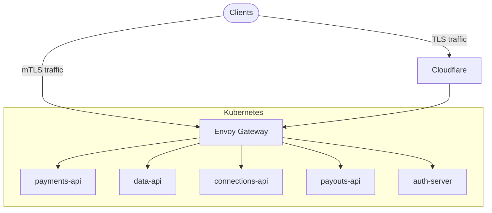
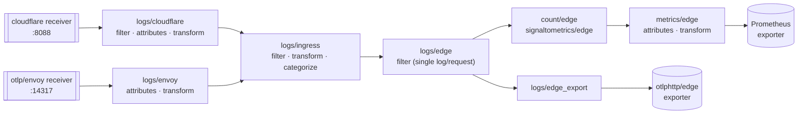
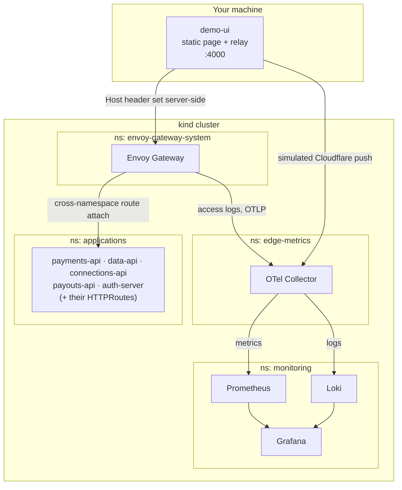

# Architecture

## Ingress paths

Envoy Gateway logs every request it handles (both TLS and mTLS); Cloudflare only logs non-mTLS requests. The collector treats Cloudflare's log as the "edge" log for non-mTLS traffic and Envoy's log as the "edge" log for mTLS traffic, so there's exactly one edge log per HTTP request regardless of path.

## Collector pipeline

## Local demo stack

